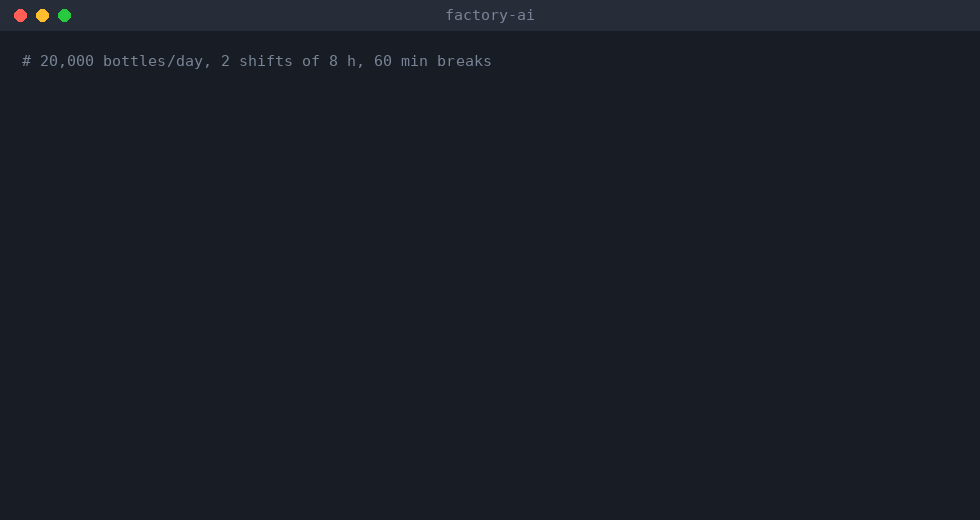
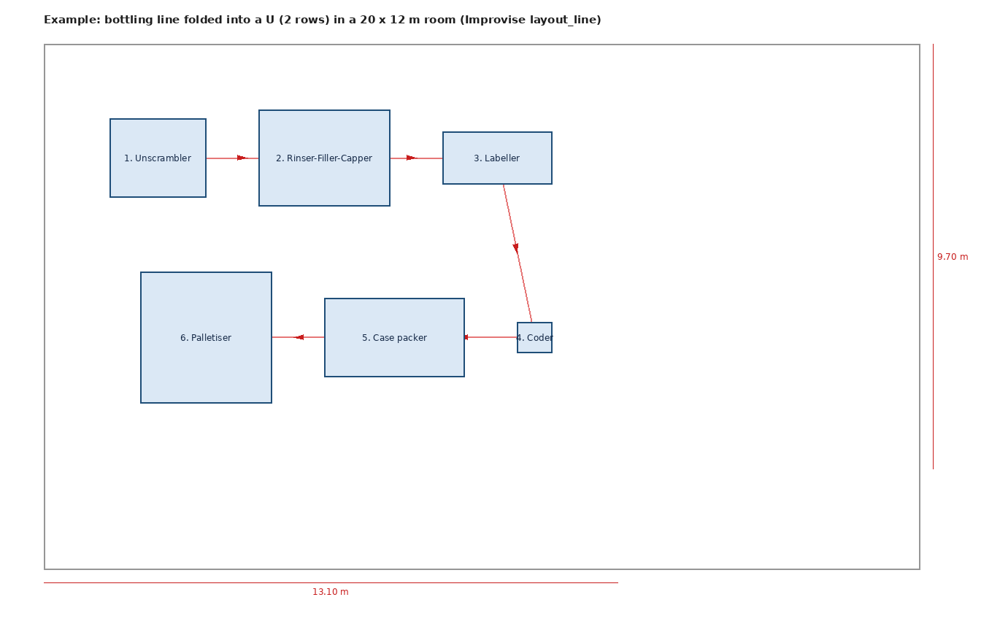

# Improvise

**Improve + wise: the local AI for production engineering that gets wiser with every project.**
Design production lines · calculate capacity, line balance, OEE and ROI · lay out lines in 2D and hand off to 3D
· produce machine lists, part lists, manuals and related documents —
and it **keeps getting better from your own verified experience**, without your data ever leaving your machine.

Free to use. PLC control logic, IoT and dashboards are coming in **Improvise Pro** (see below).

> Status: v0.5 (preview) — see [What's new](#whats-new) and [docs/ROADMAP.md](docs/ROADMAP.md)





---

## What's new

**v0.5 — 2026-10-16**
- ✨ **New name: Improvise.** factory-ai is now *Improvise* — it improves and gets wiser from every
  project you verify. The command is `improvise` (the old `factory-ai` command still works), your data
  moves from `~/.factory-ai` to `~/.improvise` automatically, and old `FACTORY_AI_*` settings are still read.

**v0.4 — 2026-10-16**
- 🧑‍💼 **You talk only to the Project Manager.** `improvise team` opens a conversation with your PM.
  Describe the project, the PM proposes a team, and **you define every position** — keep the PM's
  description or write your own responsibilities, rename, add or remove positions and choose their tools.
  Then just keep talking to the PM: it delegates to the team, the reviewer checks the work, and the PM
  reports back. Each project's team and history are saved, so you can come back to it any time.

**v0.3 — 2026-10-16**
- 👷 **Project team mode.** `improvise team "your brief"` splits the thinking into a project team:
  a Project Manager plans the work, specialists (process, layout design, electrical, QA & safety,
  cost & ROI, technical writer — plus PLC and IT/IoT engineers with Pro) each work with only their
  discipline's tools, a Senior Consultant reviews for risks and inconsistencies, and the PM writes the
  final summary. Add your own roles in `~/.improvise/team_roles.json`.

**v0.2 — 2026-10-16**
- 🔌 **MCP support.** `improvise mcp serve` lets Claude Desktop and other AI assistants use every
  Improvise tool — and record confirmed experience for you. Improvise can also use other MCP servers
  (3D/CAD, MQTT, OPC UA…); any external action needs your explicit "yes".
- 📏 **Benchmark.** `improvise bench` scores a model on real engineering questions, so a new model or
  fine-tune is released only if it is measurably better.
- 🗺️ **Better layouts.** U-shaped / serpentine lines now turn correctly, with flow lines in the drawing.

Full history: [CHANGELOG.md](CHANGELOG.md)

## What it does (free edition)

| Module | Capabilities | Code |
|---|---|---|
| Line calculations | takt time, machine count (OEE-adjusted), bottleneck, line balancing (RPW), buffer sizing | `improvise/calc/line.py` |
| OEE / ROI | OEE split into A × P × Q with the main loss; payback, NPV, IRR | `calc/oee.py`, `calc/roi.py` |
| Documents | machine list, part list (Excel), O&M manual (Markdown/Word) — unknown prices are left blank | `documents.py` |
| Layout | place machines in flow order (straight, U or serpentine), check room fit, export SVG + JSON for 3D | `layout.py` |
| Knowledge | searchable engineering knowledge base, plus your own notes in `~/.improvise/knowledge` | `knowledge.py` |
| Learning | experience memory, engineer-confirmed rules, dataset export for fine-tuning | `memory.py` |
| Community | anonymised contribution packs to help train the shared model | `contribute.py` |
| Benchmark | engineering questions graded against the calculation tools | `bench.py` |
| MCP | serve Improvise to other AI assistants; use other MCP servers safely | `mcp.py` |
| Project team | PM, consultant and discipline specialists working a brief together | `team.py` |

Core principle: **the AI never guesses numbers.** Every figure comes from a tested calculation function;
the language model's job is to understand the request, pick the right tools and explain the result.

## Installation (Windows / macOS / Linux)

1. Install Python 3.10+ and [Ollama](https://ollama.com).
2. Pull a model that supports tool calling, sized to your GPU — roughly 7–8B for 6–8 GB of VRAM,
   14B or larger for 12 GB and up. For example:
   ```bash
   ollama pull qwen2.5:14b
   ```
   Set the model name with the `IMPROVISE_MODEL` environment variable.
3. Install Improvise:
   ```bash
   git clone https://github.com/idarinza-afk/improvise
   cd improvise
   pip install -e ".[docs]"
   improvise doctor
   ```

## Usage

```bash
improvise chat                      # interactive assistant (type /save to store an answer as a case)
improvise ask "Bottling line, 20,000 bottles/day on 2 shifts: how many 3,000 bph fillers do I need?"
improvise tools                     # list all tools
improvise run takt_time '{"demand_units":20000,"shifts":2,"hours_per_shift":8,"break_min_per_shift":60}'
improvise run layout_line examples/bottling_line.json
improvise team                      # talk to your Project Manager; it builds and leads the team
improvise team --list               # role catalogue and saved projects
improvise pro                       # see what the Pro edition adds
```

The calculation tools work without a language model — `improvise run` calls them directly.

### Use it from Claude Desktop or other AI assistants (MCP)

Add Improvise to your MCP client configuration (for Claude Desktop: `claude_desktop_config.json`):

```json
{
  "mcpServers": {
    "improvise": { "command": "improvise", "args": ["mcp", "serve"] }
  }
}
```

The assistant can then call the calculation, layout and document tools, and save rules and
verified cases you confirm (`add_rule`, `verify_case`, `add_verified_case`).

To let Improvise use other MCP servers, list them in `~/.improvise/mcp.json`:

```json
{
  "servers": {
    "cad":  { "command": "uvx", "args": ["some-cad-mcp"] },
    "mqtt": { "command": "python", "args": ["-m", "my_mqtt_mcp"], "read_only": true }
  }
}
```

`improvise mcp tools` lists what is connected. Tools that could change anything ask for confirmation every time.

### Making it smarter

```bash
improvise memory add --kind line_design --title "Egg packing line" --problem "..." --solution "..."
improvise memory verify 1 "On site the sealer was the bottleneck; needed 10% more speed"
improvise memory rule "egg line" "Always add a 10% buffer before the sealer"
improvise memory export dataset.jsonl     # for periodic LoRA fine-tuning
```

### Is a new model really better?

```bash
improvise bench --model qwen2.5:14b                      # score a model on engineering questions
improvise bench --model my-finetune --compare old.json   # release only if it beats the previous one
```

The benchmark (`improvise/benchmarks/*.jsonl`) checks numbers against the calculation tools,
tool use, knowledge, and whether confirmed experience changes the answer.

Details: [docs/LEARNING.md](docs/LEARNING.md) · Help train the shared model: [CONTRIBUTING.md](CONTRIBUTING.md)

## Improvise Pro (coming soon)

Takes the line you designed in the free edition into control and automation.

| Capability | Details |
|---|---|
| **PLC control logic** | I/O list generated from the machine list, sequences converted to IEC 61131-3 Structured Text, standard function blocks (motor, valve, conveyor, alarm), automatic code checking, compiling with a real IEC 61131-3 compiler, simulator testing, export to Siemens TIA / Mitsubishi GX Works / Omron Sysmac |
| **IoT** | MQTT / OPC UA tag maps from the I/O list, read-only edge collector code, live OEE from MQTT, gateway configuration |
| **Dashboards** | OEE and production dashboards built from your lines' data, downtime and reject analysis, shift reports and real-time dashboards |

**Pricing** (prices to be announced)

| Plan | Billing | For |
|---|---|---|
| Pro | monthly, per user | engineers, freelancers, small system integrators |
| Team | monthly, per seat + shared experience memory | system integrators, machine builders |
| Enterprise | annual + on-prem install, fine-tuning on company data, support | factories and large organisations |

Interested in trying Pro? Open a GitHub issue with the label `pro-interest`.

## Safety (read before use)

- Results are decision-support tools; the responsible engineer must check them before real-world use.
- Prices that are not supplied are always left blank — the AI never guesses prices.

See [docs/SAFETY.md](docs/SAFETY.md).

## Your data

Everything that belongs to you (experience memory, notes, output files) lives in `~/.improvise`
(change it with `IMPROVISE_HOME`), outside the repository, and is never pushed to GitHub.

## License

The free edition is licensed under the [GNU Affero General Public License v3.0](LICENSE) (AGPL-3.0).
Improvise Pro is a separate commercial product.
